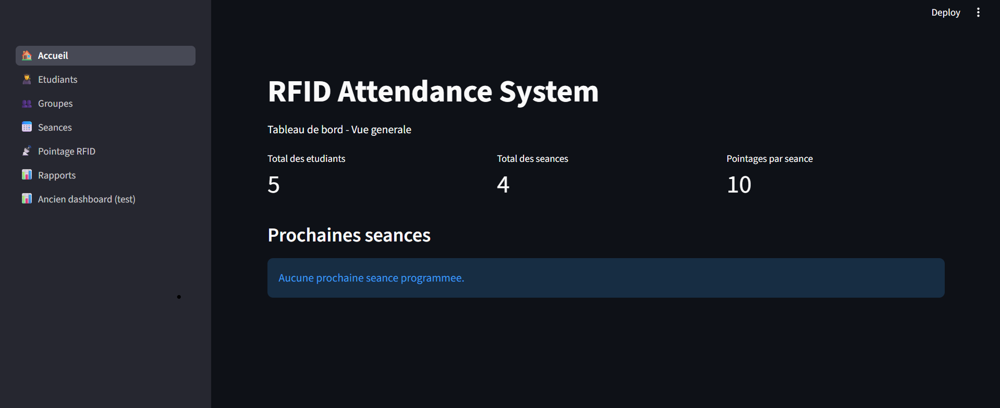
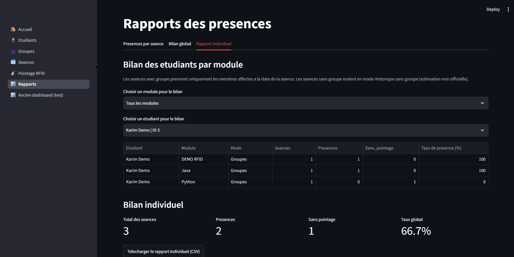
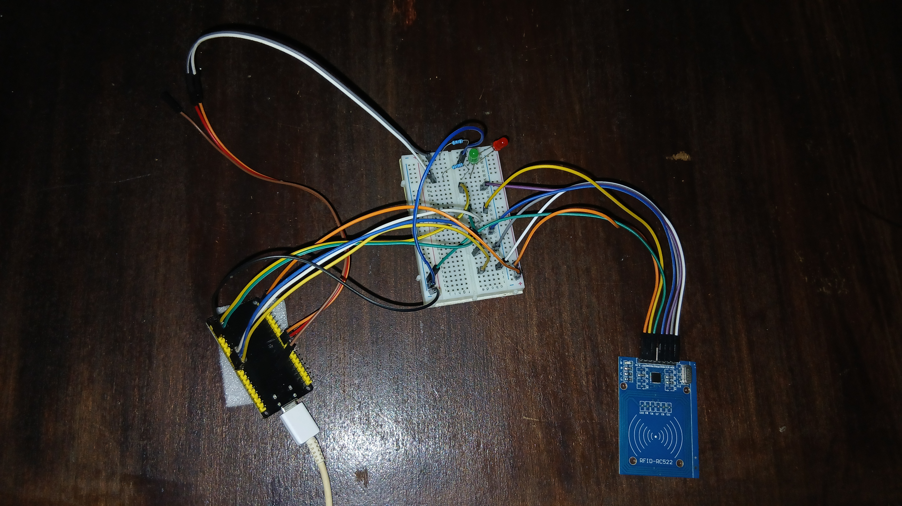

# RFID Attendance System — ESP32, Python & Streamlit

An RFID-based attendance tracking prototype that combines an **ESP32 + MFRC522 (RC522)** reader with a **Python/SQLite backend** and a **Streamlit dashboard**. It automatically records attendance during scheduled class windows, applies group eligibility rules, and provides immediate serial feedback.

> **Status:** Tested MVP / portfolio prototype. Automatic scanning and group validation were tested with real hardware. Physical green and red LEDs are implemented and tested. Serial acknowledgments remain available for debugging. This is not a production-grade, multi-user access-control system.

## Features

- **Hands-free RFID attendance:** students tap their card; no per-card button click is needed.
- **Schedule-aware scanning:** the background worker automatically detects the active class and enforces an attendance window.
- **Configurable attendance window:** `full` (entire class), `half` (first half), or a fixed number of minutes (e.g., `15`).
- **Student and group management:** membership dates are considered when validating attendance for each class.
- **Duplicate prevention:** one recorded attendance per student and class, plus a short repeat-scan filter.
- **Immediate feedback via serial:** `LED:GREEN` for a newly recorded attendance; `LED:WHITE` for a rejected or repeated scan. The ESP32 acknowledges with `LED_SIM:GREEN` / `LED_SIM:WHITE`.
- **Streamlit interface:** student records, groups, sessions, RFID monitoring, reports, and a dashboard.
- **SQLite persistence:** attendance and schedule data remain local to the installation.
- **Automated tests:** a hardware-independent Python test suite.

## Architecture

```text
                  RFID card
                      |
                      v
               MFRC522 / RC522
                      | SPI
                      v
                    ESP32
                      | USB Serial (115200 baud)
                      | "Card UID: ..."
                      v
             RFID Auto Worker (Python)
                |             |
                |             +-- Checks active session/window
                |             +-- Checks student/group membership
                |             +-- Prevents duplicate attendance
                v
              SQLite <-------- Streamlit UI
                |
                v
            Validation result
                |
                +-- "LED:GREEN" or "LED:WHITE" --> ESP32
                        (serial-only LED simulation)
```

**Source of truth:** the Python/SQLite service determines attendance status. The ESP32 firmware does not independently decide which students are registered.

## Hardware

- ESP32 development board
- MFRC522 (RC522) RFID module and compatible RFID cards/tags
- Breadboard and jumper wires
- USB cable connected to a computer running the Python worker

### RC522 to ESP32 wiring

| RC522 pin | ESP32 pin |
|---|---|
| SDA / SS | GPIO 5 |
| SCK | GPIO 18 |
| MOSI | GPIO 23 |
| MISO | GPIO 19 |
| RST | GPIO 22 |
| 3.3V | 3V3 |
| GND | GND |

**Power the MFRC522 from 3.3 V, not 5 V.** The physical firmware supports a green LED on GPIO 25 and a red LED on GPIO 26.

## Software requirements

- Windows with Python **3.10+** (Python 3.11+ recommended)
- Arduino IDE with ESP32 board support
- Arduino library **MFRC522**
- Python dependencies listed in [`requirements.txt`](requirements.txt)
- A free serial port for the ESP32, such as `COM7` (the actual port can vary)

## Installation (Windows PowerShell)

### 1. Clone or download

```powershell
git clone <YOUR-REPOSITORY-URL>
cd <YOUR-REPOSITORY-FOLDER>
```

If you downloaded a ZIP instead, extract it and open a terminal in the extracted folder.

### 2. Set up Python

```powershell
python -m venv .venv
.\.venv\Scripts\Activate.ps1
python -m pip install --upgrade pip
python -m pip install -r requirements.txt
```

If PowerShell prevents environment activation, use `.venv\Scripts\python.exe` in place of `python` in the commands below.

### 3. Initialize a **new local** database

```powershell
python database.py
python protection_affectations.py
```

This creates the local `attendance.db` tables and installs group-membership overlap protection. Do **not** copy another user's `attendance.db` into this repository. For upgrading an existing installation, back up the database first and review `migration_groupes.py`.

### 4. Upload the ESP32 firmware

Open `arduino/RFID_Attendance_ESP32_LED_TEST.ino` in Arduino IDE, select your ESP32 board and serial port, then upload. The firmware reads RFID UIDs and accepts feedback commands from Python. Close Arduino IDE's **Serial Monitor** before running the Python worker, because only one program can own the serial port at a time.

### 5. Configure students, groups and sessions

Start the web interface:

```powershell
python -m streamlit run app.py --server.port 8501
```

In the app, register students using their cards, create groups, assign membership periods, create class sessions, and associate sessions with the appropriate groups. New attendance is rejected if an active session has no assigned group.

### 6. Start continuous scanning

In a **second** terminal in the same project folder, run:

```powershell
.\demarrer_rfid_auto.bat
```

The included Windows launcher uses:

```bat
set "RFID_SCAN_WINDOW=half"
set "RFID_PORT=COM7"
```

Change `COM7` to your actual ESP32 port. The worker stays running between cards and sessions; **no click is needed for each scan**. Keep the computer awake and the worker terminal open. Use `Ctrl+C` to stop it. Do not run multiple workers against the same reader.

During a valid attendance window, a newly accepted card receives a green-feedback command. Out-of-group cards, duplicates, unknown cards and scans outside an allowed window receive white feedback. The firmware prints the simulated acknowledgment; **the physical firmware also drives the green and red LEDs**.

## Attendance window examples

For a class from **08:30 to 10:30**:

| Setting | Window accepting scans |
|---|---|
| `full` | 08:30–10:30 |
| `half` | 08:30–09:30 |
| `15` | 08:30–08:45 |

The worker determines the active class from the computer's local clock and the session schedule. If multiple sessions overlap, scanning is refused rather than arbitrarily selecting one.

## Tests

Run the tests **without attaching RFID hardware**:

```powershell
python -m unittest discover -s tests -v
```

Tests use temporary/in-memory data and cover attendance eligibility, duplicates, scheduled windows, reporting, serial-feedback commands and anti-repeat behavior. The original project passed **59 tests** in its tested development version; rerun this command on your clone to verify your environment and this published copy.

To test feedback encoding without an ESP32:

```powershell
python simuler_led_serial.py
```

## Project layout

```text
.
├── app.py                     # Streamlit entry point
├── database.py                # SQLite schema and connections
├── etudiants_page.py          # Student management
├── groupes_page.py            # Group membership management
├── seances_page.py            # Session scheduling
├── pointage_page.py           # RFID status and manual fallback
├── pointage_service.py        # Attendance validation/business rules
├── rfid_auto_worker.py        # Continuous RFID reader process
├── rfid_led_feedback.py       # Serial LED feedback protocol
├── rfid_reader.py             # Manual RFID reader helper
├── rapports_page.py           # Attendance reports UI
├── rapports_service.py        # Report calculations
├── protection_affectations.py # SQLite overlap-protection triggers
├── migration_groupes.py      # Group-table migration for existing DBs
├── demarrer_rfid_auto.bat     # Windows auto-worker launcher
├── arduino/                   # ESP32 sketch
├── tests/                     # Automated Python tests
└── requirements.txt
```

Additional support modules and the legacy dashboard are included in the repository.

## Privacy and limitations

- Never commit actual student identities, card UIDs, `attendance.db`, passwords, serial logs, exports or real attendance records.
- Use only fictional/demo data in screenshots or videos.
- Card UID matching is **not secure authentication**: basic RFID identifiers can be copied. This project is a teaching/portfolio attendance prototype, not a security system.
- The worker requires a connected and powered ESP32, an awake computer, and the correct serial port.
- Physical LED feedback is implemented using GPIO 25 and GPIO 26.
- This is a local SQLite application without authentication/roles, centralized multi-computer synchronization or production-grade monitoring.

## Demo and future improvements

A demonstration can show: (1) automatic card registration during a class, (2) rejection of a card outside its assigned group, (3) duplicate-scan prevention, (4) automatic transition to the next session, and (5) Streamlit reports. Replace this paragraph with a link to a demo video once one is ready.

Potential improvements: physical green/white LEDs, a buzzer, hardware enclosure, authenticated administration, backups, improved device reconnection and deployment packaging.

## Project Screenshots

The following screenshots use fictional demo data.

### Dashboard



### Individual Attendance Report



### Hardware Prototype



## Physical LED Feedback

The system includes two physical LEDs connected to the ESP32.

| Component | ESP32 GPIO | Function |
|---|---|---|
| Green LED | GPIO 25 | Attendance successfully registered |
| Red LED | GPIO 26 | Attendance rejected or already recorded |

Each LED uses a current-limiting resistor.

Python validates the attendance using SQLite and sends
`LED:GREEN` or `LED:WHITE` through USB Serial.

The ESP32 activates the appropriate physical LED
for 800 milliseconds.

The `LED:WHITE` command is retained for compatibility
with the existing Python worker, but activates the red LED.

### Firmware

- `RFID_Attendance_ESP32_LED_TEST.ino`: Serial LED simulation
- `RFID_Attendance_ESP32_LED_PHYSICAL.ino`: Physical LEDs

The physical LED version has been tested with
the RFID reader and automatic attendance worker.

## License

This project is licensed under the MIT License. See [LICENSE](LICENSE) for details.
